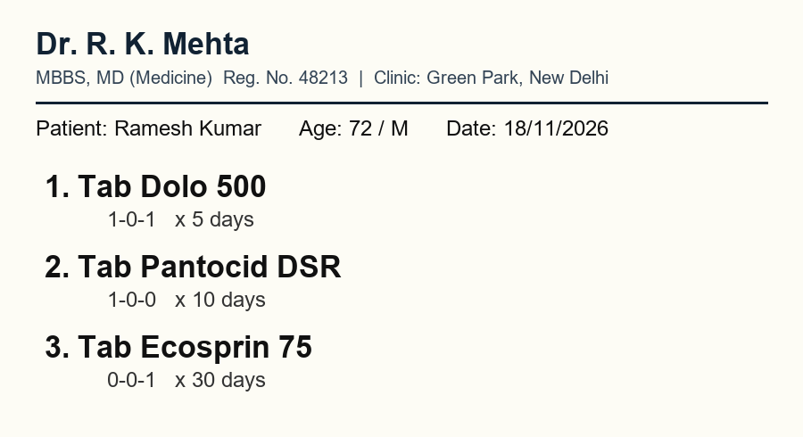
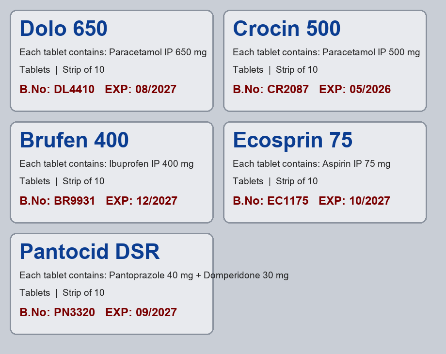

# 🚀 Buildathon: Make Wednesdays Great Again

**Masters' Union · For AI Developers · Winner gets Rs. 25,000**

> **Every team must build in a fork of this repository.** Projects not built in a fork of this repo won't be judged.

| | |
|---|---|
| **Date** | Wednesday, 18 November 2026 |
| **Hacking** | **3:00 PM – 7:00 PM IST** (code freeze at 7:00 PM sharp) |
| **Venue** | CDS Audi, 8th floor |
| **Prize** | Rs. 25,000 to the winning team |
| **Register your fork** | 👉 **[https://forms.gle/ZJUYKwTYjsMsVB2b9](https://forms.gle/ZJUYKwTYjsMsVB2b9)** (**deadline 3:30 PM IST**) |
| **Final submission** | Your fork as it stands at **7:00 PM IST**. There's nothing else to submit. |

> 🤖 **Using an AI coding agent?** Point it at [`AGENTS.md`](AGENTS.md). It has the full event brief, tracks, judging and rules in a form agents can read directly. Claude Code loads it automatically through `CLAUDE.md`, and Codex reads `AGENTS.md` natively.

---

## 🎯 Pick one build track

| # | Track | Brief |
|---|---|---|
| **01** | **Build for the Physical World** | Make a real-world task easier, faster or more reliable. Show it in a realistic scenario. |
| **02** | **Build for AI Agents** | Find something an agent struggles with. Build the tool that fixes it, then demo the agent using it. |
| **03** | **Build in Your Area of Expertise** | Pick a field you know firsthand. Ship a working product that improves how people handle it today. |

## ⚖️ How you'll be judged (each criterion is ⅓ of your score)

| Criterion | The question judges ask |
|---|---|
| **Working product** | Does it do what you say it does? Show the core workflow in your demo. |
| **Problem insight** | Who faces this problem, and why does it happen? |
| **Depth of execution** | How well did you solve the hardest part of the build? |

---

## Why fork this repo?

Everyone starts from the same commit (the **genesis commit**) at the same time. Organizers can then check that:
- all code was written **during** the Buildathon and not brought in from an earlier project,
- teams commit steadily instead of pasting in one huge AI-generated dump at the end,
- every repo stays public and visible while you build.

The organizers track every fork automatically: commits, timing and activity. Read [RULES.md](RULES.md) before you write any code.

---

## ✅ Setup (about 5 minutes, do it at 3:00 PM)

**In short:** fork → register your fork in the form **by 3:30 PM** → build → push before 7:00 PM.

### 1. Fork this repo
Click **Fork** (top right). On the fork screen:
- **Owner:** one team member's personal account. Only **one fork per team**.
- **Repository name:** `buildathon-<team-name>`, for example `buildathon-byte-bandits`
- Click **Create fork**.

> ⚠️ Don't download a ZIP or copy the files into a new repo. **It has to be a real GitHub fork**, or the tracker can't see you.

### 2. Keep it public
Forks of a public repo are public. **Don't make it private, archive it, or delete it** until judging is over.

### 3. Add your teammates
In your fork: **Settings → Collaborators → Add people**. Add each teammate's GitHub account so their commits count toward the team.

### 4. Enable Actions
Open the **Actions** tab of your fork and click **"I understand my workflows, go ahead and enable them"**. This runs the automatic check on every push.

### 5. Make your registration commit (your first commit)
Fill in [`team.json`](team.json). `track` must be one of `physical-world`, `ai-agents` or `area-of-expertise`. Then:

```bash
git clone https://github.com/<your-username>/buildathon-<team-name>.git
cd buildathon-<team-name>
# edit team.json
git add team.json
git commit -m "register: <team name>"
git push
```

The **Hackathon check** in the Actions tab should go green ✅. If it's red, open the run to see what's wrong in `team.json`.

### 6. Register your fork (deadline: 3:30 PM IST)
👉 **[https://forms.gle/ZJUYKwTYjsMsVB2b9](https://forms.gle/ZJUYKwTYjsMsVB2b9)**

It's a 4-question Google Form: team name, fork link, track, team members. It connects your repo to the organizers' live tracker.

- Fill it in **once per team**, right after forking, and **no later than 3:30 PM IST**. **Teams that don't register can't be tracked.**
- Paste your **fork's** URL (`https://github.com/<you>/buildathon-<team-name>`), not this starter repo's.
- Need to change something? Use the **"Edit your response"** link on the confirmation page. Don't fill it in twice.
- **Final submission is automatic.** Whatever is pushed to your fork at 7:00 PM IST is what gets judged.

---

## 🛠 While you build (3:00 – 7:00 PM)

- Put your code anywhere in the repo (`app/`, `src/`, `frontend/`, `backend/`…). There's no required layout.
- **Commit early, commit often**, at least every 30 minutes of real work, with messages that say what changed.
- **Push regularly.** Commits you never push don't exist to the tracker.
- AI coding tools (Claude Code, Codex, Cursor, Copilot…) are **allowed and encouraged**. Keep `AGENTS.md` and `CLAUDE.md` in the repo; they keep your agent within the rules.
- Before 7:00 PM, replace the "Your project" section below with your project's README.

## 🧊 Code freeze: 7:00 PM IST

At 7:00 PM the tracker takes a snapshot of every fork. **Commits pushed after code freeze are ignored.** Judges look at your last commit before 7:00 PM.

## ❌ Things that get you flagged

- Rewriting history (`git push --force`, rebasing away the genesis commit, squashing everything into one commit)
- Commits dated before 3:00 PM
- One or two giant commits containing most of the project
- A repo that isn't a fork of this one, or that's private or deleted

See [RULES.md](RULES.md) for the full list.

---

## Your project

# 💊 MediGuard: Prescription & Blister-Pack Discrepancy Verifier

- **Team:** MediGuard (Akshat Dhaundiyal)
- **Track:** Build for the Physical World (`physical-world`), with a Healthcare & Eldercare focus

### Problem

Elderly patients and their caregivers in India juggle several medicines with look-alike brand names. Dolo, Crocin and Calpol are all paracetamol, and Brufen with Ecosprin is a bleeding risk. Prescriptions are abbreviated, strips have tiny print, strips expire in bedside drawers, and doses get doubled by accident when a second brand of the same salt is taken. A pharmacist is not always at hand, and many homes have poor connectivity.

### What we built

Photograph the prescription and the medicine strips (or drag in images, or use the camera). MediGuard reads them and returns:

- **Green / Amber / Red cards** in English and Hindi, each labelled in words (DANGER / CAUTION / OK), not just colour.
- **A Morning / Afternoon / Night schedule** taken from the prescription (`1-0-1`, `BD`, `1-0-0-1`, "morning and night"...).
- **A read-aloud warning** in English or Hindi.
- **Two one-click demo scenarios** (a safe match and a "trap") that never depend on lighting or glare.

| Prescription (demo image) | Medicine strips (demo image) |
|---|---|
|  |  |

### The hardest part: making it safe, not just smart

The model never judges safety. The pipeline has three separate layers:

1. **Reading:** RapidOCR (CPU/ONNX, so no GPU fight with Ollama) extracts the text. Gemini Vision is used instead only if `GEMINI_API_KEY` is set.
2. **Extraction:** local Gemma 4 E2B (`temperature=0`, JSON-schema constrained) turns the OCR text into strict `PrescribedDrug` / `PhysicalStrip` records. The OCR text is passed as untrusted data.
3. **Verdict:** a deterministic Python rule engine (`safety_engine.py`, 41 Indian brands mapped to salts, 15 interaction rules) decides everything. It raises:
   `DUPLICATE_SALT`, `DOSAGE_MISMATCH`, `DRUG_INTERACTION` (including two drugs of the same class, such as two ARBs), `EXPIRED_BATCH`, plus `SALT_MISMATCH`, `NOT_PRESCRIBED`, `MISSING_STRIP`, `STRENGTH_UNVERIFIED`, `EXPIRY_MISSING` / `EXPIRY_UNREADABLE`, `UNRECOGNISED` and `SCHEDULE_UNCLEAR`.

The principle is **when unsure, never guess and never say "all clear"**:

- `Telma 80` or `Pan 20` (strengths that do not exist) become "cannot identify", not a different dose.
- A strip counts as a match only with exactly the prescribed ingredients (`Pan 40` vs `Pan-D` is flagged).
- Expiry parsing ignores MFG and batch dates and prefers the `EXP` date.
- A **grounding check** compares the model's output with the OCR text: a known medicine seen in the text but not extracted (an LLM omission or a prompt injection printed on a strip), or an extracted name that is not in the text, becomes an amber warning.
- Empty or one-sided input (no strips, no prescription) can never be green.

Reading failures are explicit: bad uploads get a clear 400/413/415, a stopped Ollama or a bad model answer gets a safe message, and a failed Gemini call falls back to the on-device reader and says so.

### Does it survive imperfect photos?

We tested tilted, blurred, noisy, low-contrast, glared, heavily JPEG-compressed and downscaled versions of the demo images ([report](docs/REPORT-hard-photos.md), generator in `fixtures/make_hard_fixtures.py`). Seven of eight kept all four RED findings. The eighth, a severe perspective skew, degraded to AMBER "cannot identify / expiry not read" warnings. **No variant produced a green result.** Handwriting was not tested and is the hardest case for OCR.

### How to run it

```bash
uv sync                           # creates .venv from pyproject.toml + uv.lock (exact versions)
ollama pull gemma4:e2b            # offline mode only
uv run uvicorn app:app --host 127.0.0.1 --port 8000
uv run pytest                     # 77 tests: rule engine, extraction path, API
```

Works the same on Windows, macOS and Linux. Without `uv`: `python -m venv .venv`, activate it, `pip install -r requirements.txt` (exported from the lock file), then `python -m uvicorn app:app --host 127.0.0.1 --port 8000`.

Open http://127.0.0.1:8000. The server warms up OCR and the model at startup (the page says so until it is ready). To enable Gemini, set `GEMINI_API_KEY` in the shell before starting (`.env` is not auto-loaded): PowerShell `$env:GEMINI_API_KEY="..."`, bash `export GEMINI_API_KEY=...`. In Gemini mode the images are sent to Google; the page says which mode ran.

### Demo

Full 3-minute script and judge Q&A: [docs/DEMO.md](docs/DEMO.md). Short version:

1. Click **Scenario 1: Safe Match** for the green result with the daily schedule.
2. Click **Scenario 2** for the trap: Dolo 650 + Crocin 500 (hidden duplicate paracetamol, Crocin expired), Brufen + Ecosprin (bleeding interaction), Dolo 650 on the strip against 500 prescribed.
3. Upload `fixtures/rx_sample.png` and `fixtures/strips_mismatch.png` and click **Verify** to run the real OCR and Gemma pipeline (about 10-20 seconds warm, 1-2 minutes if the model has to load first on a 6 GB GPU).

### Limitations

- Printed text works well; messy handwriting is not supported and degrades to amber warnings.
- The database has 41 brands and 15 interaction rules. It is a demo knowledge base, not a complete formulary.
- The Hindi text has not been reviewed by a native speaker.
- The demo images in `fixtures/` are synthetic; we have tested degraded copies of them, not a large set of real phone photos.
- `fixtures/real/` holds six real strip photos downloaded from the internet (see its [ATTRIBUTION.md](fixtures/real/ATTRIBUTION.md): sources were not recorded and some carry retailer watermarks). Read one at a time, Dolo, Crocin, Brufen, Combiflam and Telma are recognised; the Pantocid photo also produces junk entries. Photograph or upload **one strip per image**: a collage of several strips reads poorly, and identical strips with the same batch in one photo count as one.

_MediGuard is a safety aid, not medical advice. Always confirm with your doctor or pharmacist._
